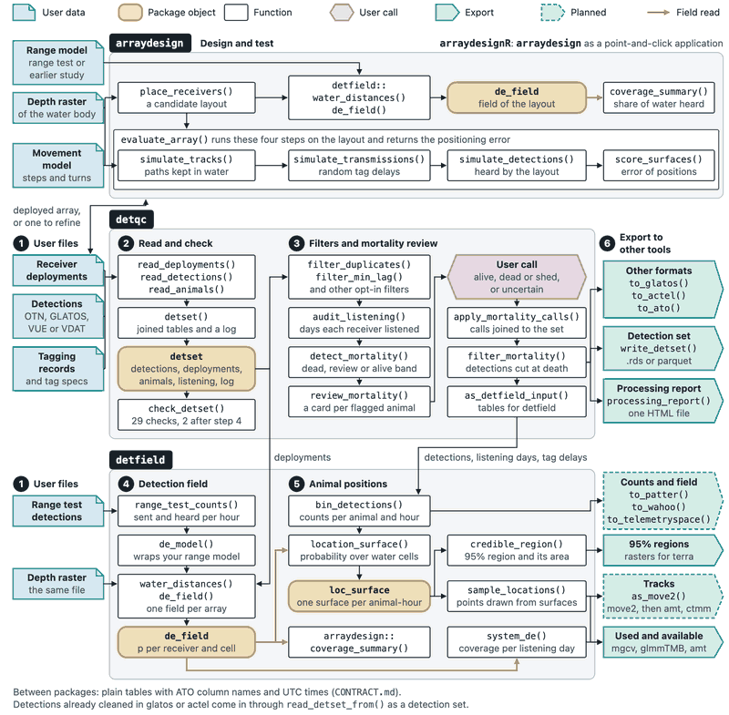

---
output:
  github_document:
    html_preview: false
    md_extensions: -smart
---

<!-- README.md is written from README.Rmd with rmarkdown::render("README.Rmd"); edit README.Rmd. -->

```{r setup, include = FALSE}
# Draw the README figure 1600 px wide at 150 dpi.
knitr::opts_chunk$set(collapse = TRUE, comment = "#>",
                      fig.path = "man/figures/README-",
                      fig.width = 32 / 3, dpi = 150, out.width = "100%")
options(width = 76)
# Write counts below ten as words.
nw <- function(n) {
  if (n < 10) c("no", "one", "two", "three", "four", "five", "six", "seven", "eight",
                "nine")[n + 1] else format(n, big.mark = ",")
}
```

# detqc 

[-blue.svg)](https://www.gnu.org/licenses/gpl-3.0)

**detqc** reads detection files from OTN, GLATOS and InnovaSea, and tagging and receiver
deployment files from OTN and GLATOS, runs a range of data checks and filters,
reviews mortality, and generates a processing report. It writes the result for the
[**detfield**](https://jakebrownscombe.github.io/detfield/) R package, the
[**glatos**](https://ocean-tracking-network.github.io/glatos/) and
[**actel**](https://actel.trackyverse.org/) R packages, or the ATO tables.

## Install

```r
install.packages("remotes")
remotes::install_github("jakebrownscombe/detqc", build_vignettes = TRUE,
                        dependencies = TRUE)
```

To install the whole suite at once, see the [positionR landing
page](https://jakebrownscombe.github.io/positionR/).

## Example

The example files are a synthetic study of four walleye tracked by 20 receivers in Stoney Lake,
Ontario, from 2 to 10 June 2024.

```{r map, fig.height = 52 / 7.5, fig.alt = "Map of Stoney Lake shaded by depth, with the receiver stations as rings sized by detections and labelled by station; six stations, north and east of the station medians, heard no detections and are white rings."}
library(detqc)
in_file <- function(name) system.file("extdata", name, package = "detqc")
# Read the detections, the receivers and the tagging records
detections <- read_detections(in_file("stoney_detections.csv"))
deployments <- read_deployments(in_file("stoney_receivers.csv"),
                                format = "glatos")
animals <- read_animals(in_file("stoney_detections.csv"), format = "glatos")
# Join them into one detection set
dets <- detset(detections, deployments, animals)
# Map the stations over the depth of the lake
lake <- terra::rast(in_file("stoney_depth.tif"))
plot_receivers(dets, water = lake) + theme_positionr(base_size = 13)
```

```{r map-counts, include = FALSE}
stations <- plot_receivers(dets, water = lake)$data
silent <- stations$detections == 0
# The alt text places the silent stations and counts six; the knit stops
# when either changes.
stopifnot(sum(silent) == 6,
          all(stations$deploy_lat[silent] > median(stations$deploy_lat)),
          all(stations$deploy_lon[silent] > median(stations$deploy_lon)))
```

*The `r nrow(stations)` receiver stations of the example, sized by the detections each heard of the
four walleye; `r nw(sum(silent))` heard none.*

`plot_attrition()` draws what each step removed from `stoney_clean`, the same study filtered.

```{r attrition, fig.height = 4.2, fig.alt = "Bar chart of the detections of the example left after each logged step, from detset to filter_mortality, with the detections each step removed written in its bar."}
# Draw the detections left after each step of the filtered study
plot_attrition(stoney_clean) + theme_positionr(base_size = 13)
```

```{r attrition-counts, include = FALSE}
log_steps <- detset_log(stoney_clean)
big <- function(n) format(n, big.mark = ",")
```

*Detections left after each logged step, from `r big(log_steps$rows_before[1])` read (dashed
line) to `r big(tail(log_steps$rows_after, 1))` kept. The mortality cut removed
`r big(log_steps$removed[log_steps$step == "filter_mortality"])`, all of them ST-02's.*

## Articles

- [Get started with **detqc**](https://jakebrownscombe.github.io/detqc/articles/detqc.html)
  runs the example once, from the files to the processing report.
- [Base processing: read, check, and filter telemetry
  data](https://jakebrownscombe.github.io/detqc/articles/reading-files.html) reads your files and
  runs every check and filter.
- [Mortality filtering: base algorithm and review
  cards](https://jakebrownscombe.github.io/detqc/articles/mortality-review.html) flags potential
  mortalities and brings your calls back from the review cards.
- [Export the dataset and generate a summary
  report](https://jakebrownscombe.github.io/detqc/articles/exporting.html) writes the set for
  other tools and writes the processing report.

## The suite

**detqc** is one of the four positionR packages, which share one set of column names and one
example study, Stoney Lake.



- [positionR, the suite](https://jakebrownscombe.github.io/positionR/)
- [**detqc**](https://jakebrownscombe.github.io/detqc/): read, check and filter detections.
- [**detfield**](https://jakebrownscombe.github.io/detfield/): detection fields and positions.
- [**arraydesign**](https://jakebrownscombe.github.io/arraydesign/): design and test the performance of tracking systems.
- [**arraydesignR**](https://jakebrownscombe.github.io/arraydesignR/): **arraydesign** as a point-and-click application.

**detfield** exports the same five figure functions as **detqc**. The copies are identical, so
the masking message R prints when both are attached can be ignored.

## Cite

```{r cite, echo = FALSE, results = "asis"}
cat(format(citation("detqc"), style = "textVersion"), sep = "\n\n")
```

## How the code was written

The code and this documentation were written with an AI coding assistant, Claude Code v2.1.145.

## Licence

GPL (>= 3).
