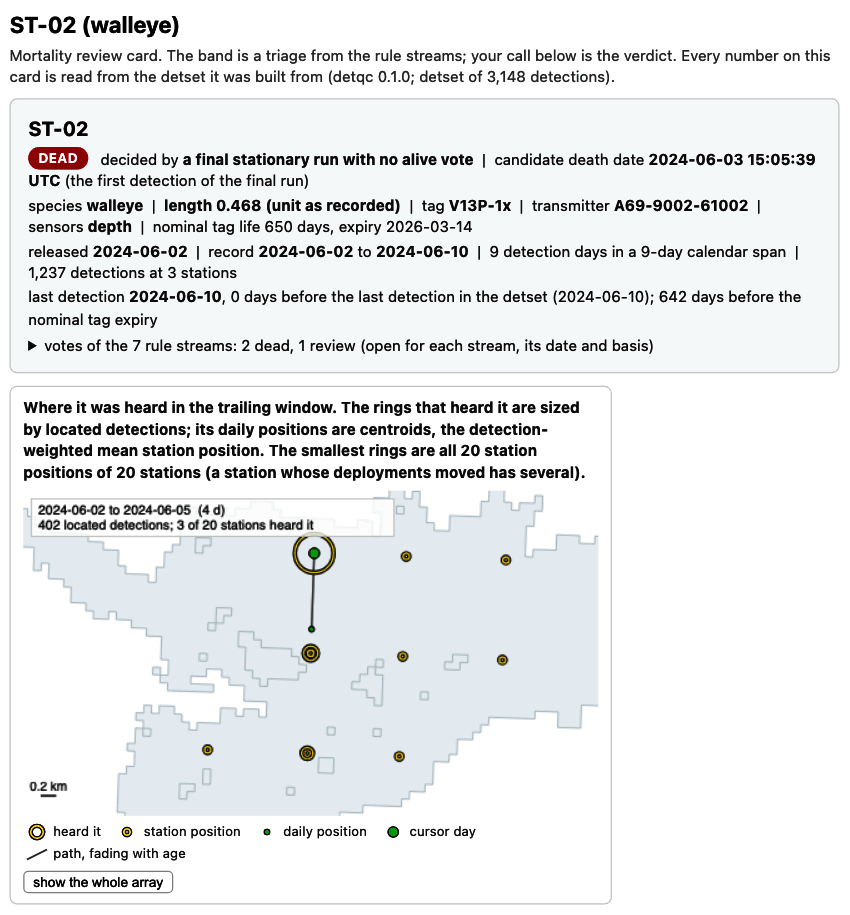
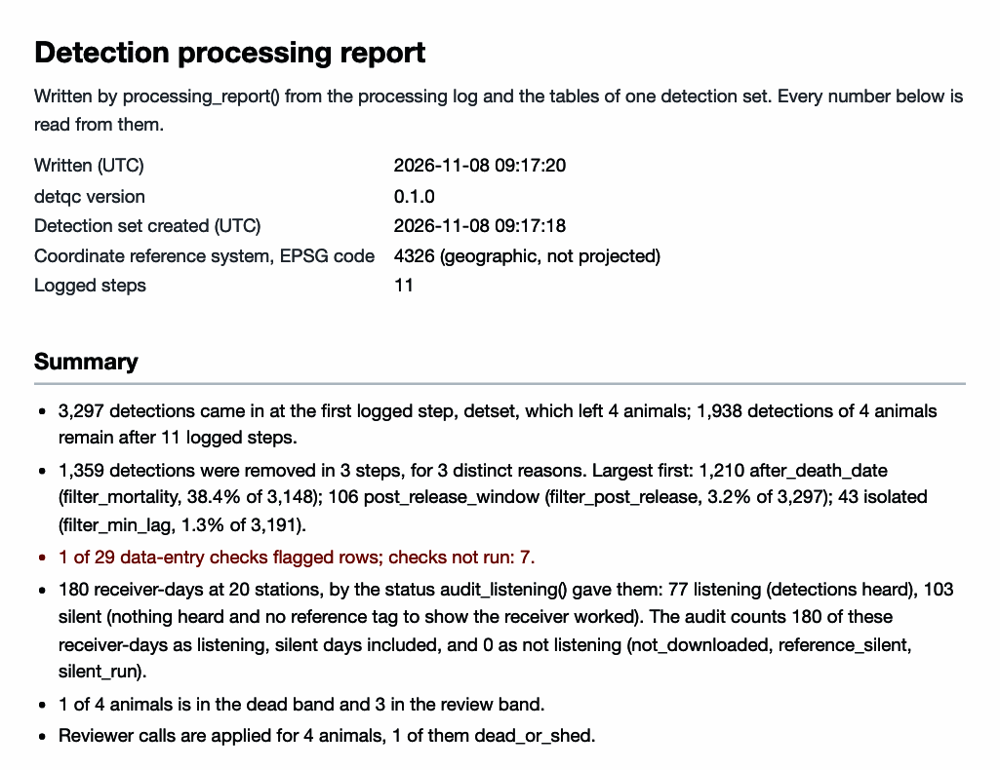

```{r setup, include = FALSE, purl = FALSE}
knitr::opts_chunk$set(collapse = TRUE, comment = "#>",
                      fig.width = 8, dpi = 150, out.width = "100%")
options(width = 76)
# Wrap long lines of output, such as the print of a detection set, to
# the column.
local({
  wrap <- function(hook) {
    force(hook)
    function(x, options) {
      lines <- strsplit(x, "\n", fixed = TRUE)[[1]]
      wide <- startsWith(lines, "#> ") & nchar(lines) > 79
      lines[wide] <- vapply(lines[wide], function(l) {
        body <- sub("^#> ", "", l)
        lead <- nchar(sub("^( *).*$", "\\1", body))
        body <- strwrap(body, width = 75, indent = lead, exdent = lead + 2)
        paste0("#> ", body, collapse = "\n")
      }, "")
      hook(paste0(paste(lines, collapse = "\n"), "\n"), options)
    }
  }
  for (h in c("output", "message", "warning", "error")) {
    knitr::knit_hooks$set(setNames(list(wrap(knitr::knit_hooks$get(h))), h))
  }
})
big <- function(n) format(n, big.mark = ",")
# Write counts below ten as words.
nw <- function(n) {
  if (n < 10) c("no", "one", "two", "three", "four", "five", "six", "seven",
                "eight",
                "nine")[n + 1] else big(n)
}
# The length of the study in days, for the caption of the card below.
study_days <- local({
  d <- as.Date(detqc::detqc_example$detections$datetime, tz = "UTC")
  as.integer(max(d) - min(d)) + 1L
})
```

**detqc** takes an acoustic telemetry study from its detection, receiver and tagging files to a
checked and filtered detection set, ready to analyse or hand to another tool. It reads OTN, GLATOS,
VUE and VDAT files, checks them for data-entry errors and filters the detections, and it logs every
step with the detections it removed. The review cards
are one HTML page per animal the mortality rules flag, on which you call the animal alive, dead or
shed. The processing report is one HTML page that records every file read, check, filter and call,
with its counts.

<div style="display: flex; gap: 1.5em; align-items: flex-start; margin: 1em 0;">
<figure style="flex: 1; margin: 0;">
<a href="../example/mortality_review/index.html"></a>
<figcaption><em>The top of the review card of ST-02, the walleye of the example that dies on
4 June. The example's rules are scaled to its `r nw(study_days)`-day study (step 6).
<a href="../example/mortality_review/index.html">Open the four review cards</a>.</em></figcaption>
</figure>
<figure style="flex: 1; margin: 0;">
<a href="../example/processing_report.html"></a>
<figcaption><em>The top of the processing report of the example.
<a href="../example/processing_report.html">Open the processing report</a>.</em></figcaption>
</figure>
</div>

The fuller workflows are in three articles.
[Base processing: read, check, and filter telemetry data](reading-files.html) reads your own files
and runs every check and filter.
[Mortality filtering: base algorithm and review cards](mortality-review.html) sets the rules,
writes the review cards and brings your calls back.
[Export the dataset and generate a summary report](exporting.html) hands the set to other tools
and writes the report.

This page runs the package once, end to end, on the Stoney Lake example files included with it: a
synthetic study of four walleye tracked by 20 receivers from 2 to 10 June 2024. Each step links
to the article that goes deeper.

## 1. Read the files

The import functions recognise each file format from its column names and return every time in
UTC; [Supported file formats](reading-files.html#supported-file-formats) lists them, with column
maps for a file of your own.

```{r read}
library(detqc)
# Locate the example files included with the package
extdata_dir <- system.file("extdata", package = "detqc")
in_file <- function(name) file.path(extdata_dir, name)

# Read the tag sheet: each transmitter's delays and sensor calibration
specs <- read_tag_specs(in_file("stoney_tag_specs.csv"))
# Read the detection export
detections <- read_detections(in_file("stoney_detections.csv"))
# Read the receiver deployments, a GLATOS receiver file
deployments <- read_deployments(in_file("stoney_receivers.csv"),
                                format = "glatos")
# Read the tagging records, joined to the tag sheet
animals <- read_animals(in_file("stoney_detections.csv"), format = "glatos",
                        tag_specs = specs)
# Show each animal's transmitter, release, delays and sensor
animals[, c("animal_id", "transmitter", "release_datetime", "min_delay",
            "max_delay", "sensor_type")]
```

The tag sheet gave each transmitter its delays, and the two depth tags their sensor type.

## 2. Build the detection set

`detset()` joins the three tables, gives each detection the station of the deployment in the water
at its time, and starts the log; `calibrate_sensors()` converts the raw depth counts to metres with
the tag sheet's calibration.

```{r build}
# Join the three tables into one detection set and start its log
dets <- detset(detections, deployments, animals)
# Convert raw sensor values to units with the tag sheet's calibration
dets <- calibrate_sensors(dets)
# Print the detection set
dets
```

`plot_receivers()` maps the stations over the depth of the lake.

```{r map, fig.height = 5.2, fig.alt = "Map of Stoney Lake shaded by depth, with the receiver stations as rings sized by detections and labelled by station; six stations, north and east of the station medians, heard no detections and are white rings."}
# Read the depth raster of the lake: 100 m cells, UTM zone 17N,
# depth stored as zero or negative metres, land NA
lake <- terra::rast(in_file("stoney_depth.tif"))
# Map the stations over the lake depth
plot_receivers(dets, water = lake) + theme_positionr(base_size = 13)
```

```{r map-counts, include = FALSE, purl = FALSE}
stations <- plot_receivers(dets, water = lake)$data
heard_none <- stations$detections == 0
silent_ids <- sort(stations$station_id[heard_none])
# The alt text places the silent stations and counts six; the knit stops
# when either changes.
stopifnot(length(silent_ids) == 6,
          all(stations$deploy_lat[heard_none] > median(stations$deploy_lat)),
          all(stations$deploy_lon[heard_none] > median(stations$deploy_lon)))
```

*The `r nrow(stations)` stations of the example; `r nw(length(silent_ids))` heard none.*

Every positionR map draws a receiver as a ring in the three colours of `positionr_ring_colours()`,
so a map from **detqc** matches one from **detfield** or **arraydesign**.

```{r ring-colours}
# The ring colours of a receiver that heard, one that heard nothing, and the edge
positionr_ring_colours()
```

## 3. Run the checks

`check_detset()` runs `r length(all_checks())` data-entry and deployment checks and never changes
the data; [What the checks
catch](reading-files.html#what-the-checks-catch) lists them all and plants four errors for them to
find.

```{r checks}
# Run every check; the raster as positive metres serves the land and
# depth checks
dets <- check_detset(dets, water = abs(lake))
# Print the checks that did not pass
checks <- dets$checks$summary
checks[checks$status != "pass", c("check", "status", "flagged", "of", "unit")]
```

```{r check-counts, include = FALSE}
silent <- checks$flagged[checks$check == "receiver_silent"]
# Test whether every deployment spans the whole detection record
det_span <- range(dets$detections$datetime)
all_whole <- all(dets$deployments$deploy_datetime <= det_span[1] &
                   dets$deployments$recover_datetime >= det_span[2])
```

`receiver_silent` flags the same `r nw(silent)` stations, those that heard none. The checks that did not run need
inputs this example does not give, such as reference tags. `plot_timeline()` draws each
deployment against time.

```{r timeline, fig.height = 4.6, fig.alt = "Deployment timeline of each station: dark bars for stations that heard a detection and light bars for stations that heard none."}
# Draw each deployment as a bar from deployment to recovery
plot_timeline(dets) + theme_positionr(base_size = 13)
```

*`plot_timeline()`: each of the `r nrow(dets$deployments)` receivers from deployment to
recovery.*

`r if (all_whole) "Every receiver was in the water from the first to the last day of the study, so the silent stations were not out of the water; [What the checks catch](reading-files.html#what-the-checks-catch) says what else a silent receiver can mean." else ""`

## 4. Audit the listening days

`audit_listening()` gives each receiver and day a listening status, which the
[**detfield**](https://jakebrownscombe.github.io/detfield/) R package, the positioning component of
positionR, reads. Run it before the filters: a detection a filter removes still shows that the
receiver was listening. With no
reference tags in this example, `known_listening` names the receivers the field records confirm
worked; [Hand off to **detfield**](exporting.html#hand-off-to-detfield) explains each status.

```{r deployed-days, include = FALSE, purl = FALSE}
# Receiver-days deployed, as the print of the set counts them before the audit
deployed_days <- nrow(dets$listening)
```

```{r audit}
# Give each receiver-day a listening status; every receiver here worked
dets <- audit_listening(dets,
                        known_listening = unique(dets$deployments$receiver_serial))
# Count receiver-days by status
table(dets$listening$status)
```

```{r audit-days, include = FALSE, purl = FALSE}
audit_days <- length(unique(dets$listening$date))
stopifnot(nrow(dets$listening) < deployed_days)
```

The audit covers the `r nw(audit_days)` UTC days from the first to the last detection: `r big(nrow(dets$listening))`
of the `r big(deployed_days)` receiver-days deployed.

A silent day, a full day with no detection, still counts as listening here, because the field
records confirm the receiver worked. Receiver logs, where you have them, show which receivers were
running and how many detections each counted ([Receiver logs](reading-files.html#receiver-logs)).

## 5. Filter the detections

`filter_duplicates()` removes repeated detections of one transmitter on one receiver at one time.

```{r filter-duplicates}
# Remove repeated detections of one transmitter on one receiver
dets <- filter_duplicates(dets)
```

`filter_post_release()` removes the first 6 h after each release, while the animals recover from
tagging.

```{r filter-post-release}
# Remove the first 6 h of each animal's record, its recovery from tagging
dets <- filter_post_release(dets, hours = 6)
```

`filter_min_lag()` removes false detections, those isolated in time: a detection with no other
detection of its transmitter on its receiver within a threshold. Following Pincock (2012), the threshold is
30 times the average delay of the tags,
`r big(30 * mean((animals$min_delay + animals$max_delay) / 2))` s here. [Isolated
detections](reading-files.html#isolated-detections-the-minimum-lag) draws the lags of this study
against it.

```{r lag-threshold}
# Set the threshold: 30 times the average delay, the mean of each tag's
# minimum and maximum delay from the tag sheet
max_lag <- 30 * mean((animals$min_delay + animals$max_delay) / 2)
max_lag
```

`filter_min_lag()` then removes the isolated detections and logs them.

```{r filter-lag}
# Remove detections isolated in time beyond the threshold, or alone
dets <- filter_min_lag(dets, max_lag_s = max_lag)
# Print the log so far: detections before and after each step
detset_log(dets)[, c("step", "rows_before", "rows_after", "removed")]
```

## 6. Detect and review mortality

`detect_mortality()` reads each record with a set of rule streams and assigns each animal a
candidate death date and a band: dead, review or alive. The default temporal settings suit studies
of months, so the code scales them to this nine-day study. [Mortality
filtering](mortality-review.html) explains each stream and band and adds a rule of your own.

```{r detect}
# Scale the temporal settings to nine days: a final run of 3 detection
# days and 3 calendar days, 2 flat sensor days, a record end within 2 days
mort_rules <- mortality_rules(min_days = 3, min_calendar_days = 3,
                              min_flat_days = 2, within_days = 2)
# Sort each animal into the dead, review or alive band
bands <- detect_mortality(dets, rules = mort_rules)
bands$bands[, c("animal_id", "band", "deciding_rule", "death_date")]
```

```{r band-check, include = FALSE, purl = FALSE}
# Guard the sentence below against a change in the bands
stopifnot(identical(as.vector(table(bands$bands$band)[c("dead", "review")]),
                    c(1L, 3L)),
          bands$bands$band[bands$bands$animal_id == "ST-02"] == "dead")
```

ST-02 falls in the dead band and the other three in review; [Flag: sort the animals into
mortality bands](mortality-review.html#step-1--flag-sort-the-animals-into-mortality-bands) gives
the rule that decides each.

`review_mortality()` writes one HTML review card per animal, with an index, on which you call each
animal; [Open the review cards](mortality-review.html#step-2--open-the-review-cards) shows how to
read one. Open [the four review cards](../example/mortality_review/index.html) this code wrote.

```{r out-dir}
# Change to a folder beside your data, such as "C:/telemetry/2024/processed".
out_dir <- tempdir()
```

```{r site-out-dir, include = FALSE, purl = FALSE}
# The package website serves the cards and the report this page writes
site_dir <- file.path("..", "pkgdown", "assets", "example")
if (dir.exists(site_dir)) out_dir <- site_dir
```

```{r cards}
# Make the outline of the lake for the maps on the cards
outline <- sf::st_as_sf(terra::as.polygons(terra::ifel(is.na(lake), NA, 1)))
# Write a card for every animal, dead, review and alive, and an index
dets <- review_mortality(dets, file.path(out_dir, "mortality_review"),
                         bands = bands, all = TRUE, open = FALSE,
                         control = list(outline = outline))
# List the cards written
dets$cards[, c("animal_id", "band", "checked")]
```

`apply_mortality_calls()` stores the calls a reviewer exports from the index; the file below stands
in for that export, with ST-02 dead at its simulated death time.

```{r calls}
# Write the calls: ST-02 dead at 02:00 UTC on 4 June, the other three alive
calls <- data.frame(animal_id = c("ST-01", "ST-02", "ST-03", "ST-04"),
                    call = c("alive", "dead_or_shed", "alive", "alive"),
                    death_date = c("", "2024-06-04", "", ""),
                    death_time = c("", "2024-06-04 02:00:00", "", ""))
calls_file <- file.path(tempdir(), "mortality_calls.csv")
write.csv(calls, calls_file, row.names = FALSE)
# Store the reviewer's calls in the detection set
dets <- apply_mortality_calls(dets, calls_file)
```

`filter_mortality()` removes each dead animal's detections from `margin_days` before its death
time. The default of 7 days would remove all of ST-02's record in a nine-day study, so the cut uses
1 day; [Decide](mortality-review.html#step-3--decide-bring-your-calls-back) compares the two.

```{r cut}
# Cut ST-02's record 1 day before its death time
dets <- filter_mortality(dets, margin_days = 1)
# Print the last two log records
tail(detset_log(dets)[, c("step", "rows_before", "rows_after", "removed")], 2)
```

## 7. Export and write the report

`as_detfield_input()` returns the three tables **detfield** reads, and `write_detset()` saves the
set with its log; [Export](exporting.html) adds `to_glatos()`, `to_actel()` and `to_ato()` and the
files other software reads.

```{r export}
# Convert the detection set to the three tables detfield reads
input <- as_detfield_input(dets)
sapply(input[c("detections", "tag_delay")], nrow)
# Save the detection set with its log
path <- write_detset(dets, file.path(tempdir(), "stoney_detset.rds"),
                     overwrite = TRUE)
basename(path)
```

`processing_report()` records the whole run on one HTML page: files, log, checks, removals by
reason, and the mortality bands and calls. Open
[the processing report](../example/processing_report.html) this code wrote.

```{r report}
# Write the processing report into out_dir
report <- processing_report(dets, file.path(out_dir, "processing_report.html"),
                            bands = bands, control = list(outline = outline))
basename(report)
```

`plot_attrition()` draws the log as the detections left after each step, the figure the report
draws.

```{r attrition-log, include = FALSE}
log_steps <- detset_log(dets)
cut_n <- log_steps$removed[log_steps$step == "filter_mortality"]
```

```{r attrition, fig.height = 4.2, fig.alt = sprintf("Bar chart of the detections left after each of the %s logged steps, from %s after reading to %s after the mortality cut.", nrow(log_steps), big(log_steps$rows_after[1]), big(tail(log_steps$rows_after, 1)))}
# Draw the detections left after each logged step
plot_attrition(dets) + theme_positionr(base_size = 13)
```

*The detections left after each of the `r nrow(log_steps)` logged steps, from
`r big(log_steps$rows_before[1])` read.*

The mortality cut removed `r big(cut_n)` detections, `r if (cut_n > sum(log_steps$removed) - cut_n) "more than every other step together" else "fewer than the other steps together"`. The set now
holds `r big(tail(log_steps$rows_after, 1))` detections, as does the included `stoney_clean`.

## References

Pincock, D. G. (2012). False detections: what they are and how to remove them from detection
data. Application note DOC-004691-03. Amirix Systems Inc. (VEMCO).
