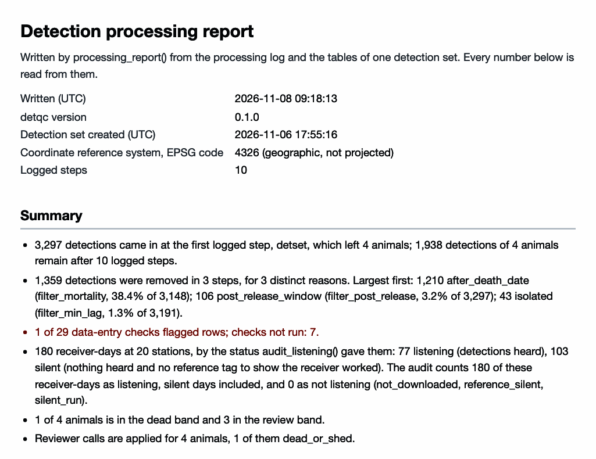

```{r setup, include = FALSE, purl = FALSE}
knitr::opts_chunk$set(collapse = TRUE, comment = "#>")
# Print to 76 columns; with the "#> " prefix a printed line is at most 79.
options(width = 76)
# Wrap long lines of output, such as the text of an error, to the column
# so that the remedy at their end is in view.
local({
  wrap <- function(hook) {
    force(hook)
    function(x, options) {
      lines <- strsplit(x, "\n", fixed = TRUE)[[1]]
      wide <- startsWith(lines, "#> ") & nchar(lines) > 79
      lines[wide] <- vapply(lines[wide], function(l) {
        body <- sub("^#> ", "", l)
        lead <- nchar(sub("^( *).*$", "\\1", body))
        body <- strwrap(body, width = 75, indent = lead, exdent = lead + 2)
        paste0("#> ", body, collapse = "\n")
      }, "")
      hook(paste0(paste(lines, collapse = "\n"), "\n"), options)
    }
  }
  for (h in c("output", "message", "warning", "error")) {
    knitr::knit_hooks$set(setNames(list(wrap(knitr::knit_hooks$get(h))), h))
  }
})
# Write counts below ten as words in the text.
nw <- function(n) {
  if (n < 10) c("no", "one", "two", "three", "four", "five", "six", "seven",
                "eight",
                "nine")[n + 1] else format(n, big.mark = ",")
}
cap_nw <- function(n) {
  w <- nw(n)
  paste0(toupper(substr(w, 1, 1)), substring(w, 2))
}
```

This page converts a detection set into the inputs of the
[**detfield**](https://jakebrownscombe.github.io/detfield/) R package, the
[**glatos**](https://ocean-tracking-network.github.io/glatos/) and
[**actel**](https://actel.trackyverse.org/) R packages, and ATO (the Animal Tracking
Object, a set of R classes from the trackyverse project, <https://ato.trackyverse.org>). It also
saves the set in files other software reads, writes the processing report, and brings work done
in **glatos** or **actel** back into **detqc**. The code skips the **glatos**, **actel** and
**arrow** steps when their package is not installed. **detfield** has its own hand-offs to other
packages ([Hand the positions
on](https://jakebrownscombe.github.io/detfield/articles/positioning.html#hand-the-positions-on)).

```{r report-screenshot, echo = FALSE, purl = FALSE, out.width = "100%", fig.alt = "Screenshot of the top of the processing report: its header and summary.", fig.cap = "**Figure 1.** The top of the processing report that the code at the end of this page writes."}

```

## A detection set to export

The example is `stoney_clean`, the Stoney Lake study included with the package as a detection set
already read, checked, filtered and cut for mortality; [Base processing](reading-files.html) and
[Mortality filtering](mortality-review.html) show how such a set is made. Use your own set in its
place.

```{r load}
library(detqc)
# Load the Stoney Lake study, read, checked and filtered
dets <- stoney_clean
# Print the set: its tables, its log and its checks
dets
```

The code writes its files to `out_dir`, a temporary folder here. In your copy of the script, set
it to a folder beside your data.

```{r out-dir}
# Change to a folder beside your data, such as "C:/telemetry/2024/processed".
out_dir <- tempdir()
```

## Hand off to detfield

`as_detfield_input()` returns the three inputs of **detfield**'s `bin_detections()`: the
detections, the receiver listening days and the programmed transmission delays of each tag.
`audit_listening()` ran on `stoney_clean` before the filters and named every receiver of the
Stoney array in `known_listening`. With your own data, name only the receivers your field records
or the network's receiver file confirm: the silent days of a named receiver count as listening.

```{r audit-status}
# Count receiver-days by status, and give the dates the audit covers
table(dets$listening$status)
range(dets$listening$date)
```

A `listening` day is a full day in the water on which the receiver heard a transmitter, and a
`partial` day is a deployment or recovery day. A `silent` day is a full day with no detection and
no reference tag to show the receiver worked; it counts as listening. With reference tags in the
water, given in `reference_tags`, a silent day on which a receiver should have heard one is read
as not listening. Given the receivers' own logs in `logs`, the audit also finds the days a
receiver was `off` or `deaf`, which `as_detfield_input()` passes as not listening ([Receiver
logs](reading-files.html#receiver-logs)).

`as_detfield_input()` then returns the three tables.

```{r detfield}
# Make the three inputs of detfield::bin_detections()
detfield_input <- as_detfield_input(dets)
names(detfield_input)
# Show the delays of each transmitter, from the tag sheet
detfield_input$tag_delay
# List detected transmitters with no delays: none here
setdiff(unique(dets$detections$transmitter),
        detfield_input$tag_delay$transmitter)
```

`tag_delay` gives the delays from the tag specification sheet, one row per transmitter.
`bin_detections()` stops on a detected transmitter with no delays, so add its delays to the
sheet, or leave its animal out, before you go on.

The listening table has one row per receiver and day. The code below adds each receiver's
station and counts the days by status.

```{r listening-table}
# Take the receiver-day table detfield reads, with each receiver's station
listening_days <- detfield_input$listening$days
rx_row <- match(listening_days$receiver_serial, dets$deployments$receiver_serial)
listening_days$station <- dets$deployments$station_id[rx_row]
table(listening_days$status)
```

```{r listening-counts, include = FALSE, purl = FALSE}
stations_heard <- tapply(listening_days$status == "listening", listening_days$station, any)
silent_ids <- sort(names(stations_heard)[!stations_heard])
```

Drawn by station and day (Figure 2), the table shows the `r nw(sum(!stations_heard))` stations
that heard none of the four walleye on any day, `r silent_ids[1]` to `r tail(silent_ids, 1)`.

```{r listening-figure, fig.height = 4.4, fig.alt = "The receiver-day listening table handed to detfield: each Stoney station by day, listening or silent.", fig.cap = sprintf("**Figure 2.** The listening table `as_detfield_input()` returns for `stoney_clean`, one tile per station and day (%s receiver-days).", format(nrow(listening_days), big.mark = ","))}
# Draw one tile per station and day, coloured by status
ggplot2::ggplot(listening_days, ggplot2::aes(as.Date(date), station,
                                             fill = status)) +
  ggplot2::geom_tile(colour = "white", linewidth = 0.4) +
  ggplot2::scale_fill_manual(values = c(listening = "#2C5AA0",
                                        silent = "#B8C7DE",
                                        partial = "#E69F00"), name = NULL) +
  ggplot2::scale_x_date(date_labels = "%d %b", date_breaks = "1 day",
                        expand = c(0, 0)) +
  ggplot2::labs(x = "Date (UTC)", y = "Station") +
  theme_positionr() +
  ggplot2::theme(panel.grid = ggplot2::element_blank())
```

**detfield**'s article [Position fish from a cleaned
detection set](https://jakebrownscombe.github.io/detfield/articles/from-detqc.html) takes this set
on.

## glatos

`to_glatos()` returns the detections as a `glatos_detections` data frame, with the columns the
**glatos** filters and summaries read. **glatos** need not be installed to make it.

```{r glatos}
# Convert the detections to a glatos_detections data frame
glatos_dets <- to_glatos(dets)
class(glatos_dets)
head(glatos_dets[, c("animal_id", "detection_timestamp_utc", "transmitter_id",
                     "receiver_sn", "glatos_array", "station")], 3)
```

**glatos** groups detections by `glatos_array` unless told otherwise, and the Stoney files put
every station in one array, `STN`. Give `location_col = "station"` to the **glatos** functions to
work by station, as below, or fill `glatos_array` with your own array codes.

```{r glatos-events}
if (requireNamespace("glatos", quietly = TRUE)) {
  # Compute detection events by station with glatos
  events <- glatos::detection_events(glatos_dets, location_col = "station")
  head(events[, c("animal_id", "location", "first_detection", "last_detection",
                  "num_detections")], 3)
}
```

## actel

`to_actel()` returns the four tables `actel::preload()` reads: biometrics, spatial, deployments
and detections. **actel** works in the local time zone of the study area. Name that zone once, as
`tz` below, and give it to both functions: `to_actel()` writes the release and deployment times
in it, and `preload()` converts the UTC detections to it, so every table reads in one zone.

```{r actel}
# Make the four actel tables, in the time zone of the study area
tz <- "America/Toronto"
actel_input <- to_actel(dets, tz = tz)
# Count rows per table
vapply(actel_input, nrow, 1L)
head(actel_input$biometrics)
# Show the rows to_actel() left out, and those actel will drop
attr(actel_input, "dropped")
attr(actel_input, "actel_drops")
```

No detection was dropped here. `to_actel()` counts each change **actel** needs in an attribute:

- A detection with no station, or with a code that cannot be read, is left out (`dropped`).
- `actel::preload()` drops the detections of transmitters not in the biometrics and those before
  release (`actel_drops`, counted ahead of time).
- **actel** names a receiver by a whole number; the lookup is in `attr(actel_input, "receivers")`.
- In **actel**, an array is a group of stations the analysis treats as one place, in the order
  an animal meets them along a river. A lake has no such order, so `to_actel()` puts every
  station in one array, `A1`. For a river, give `to_actel()` `arrays`, the array code of each
  station named by `station_id`, and give `preload()` the matching `dot`, such as
  `"A1--A2--A3"`.

With **actel** installed, `preload()` takes the four tables and `read_detset_from()` brings the
result back.

```{r actel-preload}
# Run only when the actel package is installed
if (requireNamespace("actel", quietly = TRUE)) {
  # Load the four tables with actel
  preloaded <- do.call(actel::preload, c(actel_input, list(tz = tz)))
  # Bring the actel result back as a detection set
  from_actel <- read_detset_from(preloaded,
                                 receivers = attr(actel_input, "receivers"))
  from_actel
}
```

```{r actel-counts, echo = FALSE, results = "asis", purl = FALSE}
# The text below the block is read from the preload, so that it stays true
# when the example changes; without actel the page says the block was skipped.
if (exists("preloaded")) {
  heard_rx <- lapply(preloaded$detections.list, function(d) as.character(d$Receiver))
  quiet_rx <- setdiff(attr(actel_input, "receivers")$Receiver,
                      as.integer(unique(unlist(heard_rx))))
  actel_dep <- actel_input$deployments
  quiet_st <- sort(actel_dep$Station.name[actel_dep$Receiver %in% quiet_rx])
  n_kept <- sum(vapply(preloaded$detections.list, nrow, 1L))
  key <- function(d) {
    sort(paste(format(d$datetime, "%Y-%m-%d %H:%M:%OS3", tz = "UTC"), d$transmitter,
               d$receiver_serial, d$station_id, d$animal_id))
  }
  same <- identical(key(from_actel$detections), key(dets$detections))
  stopifnot(same, n_kept == nrow(dets$detections))
  group <- unique(actel_input$biometrics$Group)
  text <- paste(
    "**actel** warns that the group name `%s` is longer than six characters and that %s",
    "receivers heard none of the four walleye. `read_detset_from()` brings back the detections,",
    "the deployments and each animal's release; the other animal columns stay in `dets`.\n"
  )
  cat(sprintf(text, group, nw(length(quiet_rx))))
} else {
  cat("This page was built without **actel**, so the block shows no output.\n")
}
```

## ATO

`to_ato()` returns the four ATO tables `det`, `dep`, `tag` and `ani`, each with every column of
ATO's template. Build the ATO object from them with ATO's `make_det()`, `make_dep()`, `make_tag()`,
`make_ani()` and `init_ato()`.

```{r ato}
# Make the four ATO tables
ato <- to_ato(dets)
# Count rows per table, and list the columns of the tag table
vapply(ato, nrow, 1L)
names(ato$tag)
```

## Files other software reads

`write_detset()` saves the whole detection set, with its log and checks. An RDS file keeps it
exactly for R. A folder of Parquet files, written with the **arrow** package, is read by Python,
DuckDB and most other tools. `read_detset()` reads either back.

```{r files}
# Write a folder of Parquet files, when arrow is installed
set_path <- file.path(out_dir, "my_detset")
if (requireNamespace("arrow", quietly = TRUE)) {
  write_detset(dets, set_path, format = "parquet", overwrite = TRUE)
  list.files(set_path)
}
# Write one RDS file, and read it back to confirm the detections
write_detset(dets, paste0(set_path, ".rds"), overwrite = TRUE)
nrow(read_detset(paste0(set_path, ".rds"))$detections)
```

For a spreadsheet, write one table. Times are UTC; write them with the zone in the text, so that
no program reads them as local time:

```{r csv}
# Write the times as text with the UTC zone marked
det_table <- dets$detections
det_table$datetime <- format(det_table$datetime, "%Y-%m-%dT%H:%M:%SZ")
write.csv(det_table, file.path(out_dir, "detections.csv"), row.names = FALSE)
head(det_table$datetime, 3)
```

## The processing report

`processing_report()` writes one HTML file: the files read, every logged step with its counts
before and after, the checks, the detections removed by reason, the mortality bands and calls,
and the figures. It needs no internet and opens in any
browser, so hand it on with the exported tables.

Given the mortality bands from `detect_mortality()`, the report adds them to its summary. The
bands come from the set before the mortality cut, which is included as `example_mortality`, with the
rules scaled to this nine-day study as on the Get started page.

```{r bands}
# Build the set before the mortality cut from example_mortality
before_cut <- detset(example_mortality$detections,
                     example_mortality$deployments, example_mortality$animals)
# Scale the mortality rules to nine days and band the animals
mort_rules <- mortality_rules(min_days = 3, min_calendar_days = 3,
                              min_flat_days = 2, within_days = 2)
bands <- detect_mortality(before_cut, rules = mort_rules)
bands$bands[, c("animal_id", "band", "deciding_rule")]
```

Give the outline of the water body as `control = list(outline = outline)` to draw it under the
report's map of the receivers. Here the outline is made from the Stoney Lake depth raster included
with the package.

```{r outline}
# Locate the example files included with the package
extdata_dir <- system.file("extdata", package = "detqc")
in_file <- function(name) file.path(extdata_dir, name)
# Read the depth raster and make the lake outline from its water cells
lake <- terra::rast(in_file("stoney_depth.tif"))
outline <- sf::st_as_sf(terra::as.polygons(terra::ifel(is.na(lake), NA, 1)))
```

```{r report}
# Write the report file, and open it in an interactive session
report <- processing_report(dets, file.path(out_dir, "processing_report.html"),
                            bands = bands,
                            control = list(outline = outline))
basename(report)
if (interactive()) utils::browseURL(report)
```

Figure 1, at the top of the page, is the top of that report.

The site keeps the report of the Get started page: [the processing
report](../example/processing_report.html), with [the four review
cards](../example/mortality_review/index.html).

## Back into detqc

`read_detset_from()` builds a detection set from **glatos** detections or an **actel** preload, so work
started in either can be checked and logged here. Without a receiver table it infers the
deployments from the detections, 14 here against 20 deployed, and the log says so. An inferred
deployment cannot show when a receiver listened and heard nothing. Give the **glatos** receiver table
as `receivers` to keep every deployment.

```{r back}
# Rebuild a detection set from the glatos detections alone
from_glatos <- read_detset_from(glatos_dets)
from_glatos
# Show the log record that says the deployments were inferred
detset_log(from_glatos)$reason[2]
# Rebuild with the glatos receiver table, which keeps every deployment
if (requireNamespace("glatos", quietly = TRUE)) {
  receivers <- glatos::read_glatos_receivers(in_file("stoney_receivers.csv"))
  from_glatos <- read_detset_from(glatos_dets, receivers = receivers)
  from_glatos
}
```

## Next

- [Position fish from a cleaned detection
  set](https://jakebrownscombe.github.io/detfield/articles/from-detqc.html), in **detfield**:
  position the animals of the exported set.
- `?to_actel`, `?to_glatos` and `?to_ato` give every column each conversion writes.

The code of this page is also a plain R script:
`system.file("scripts", "exporting.R", package = "detqc")`. Copy it, and change `out_dir` and the
file paths to your own.
