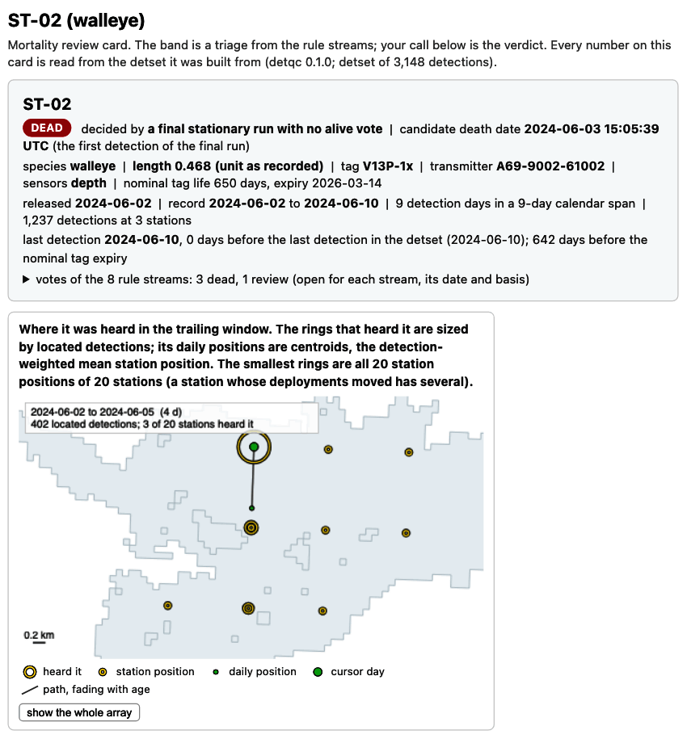
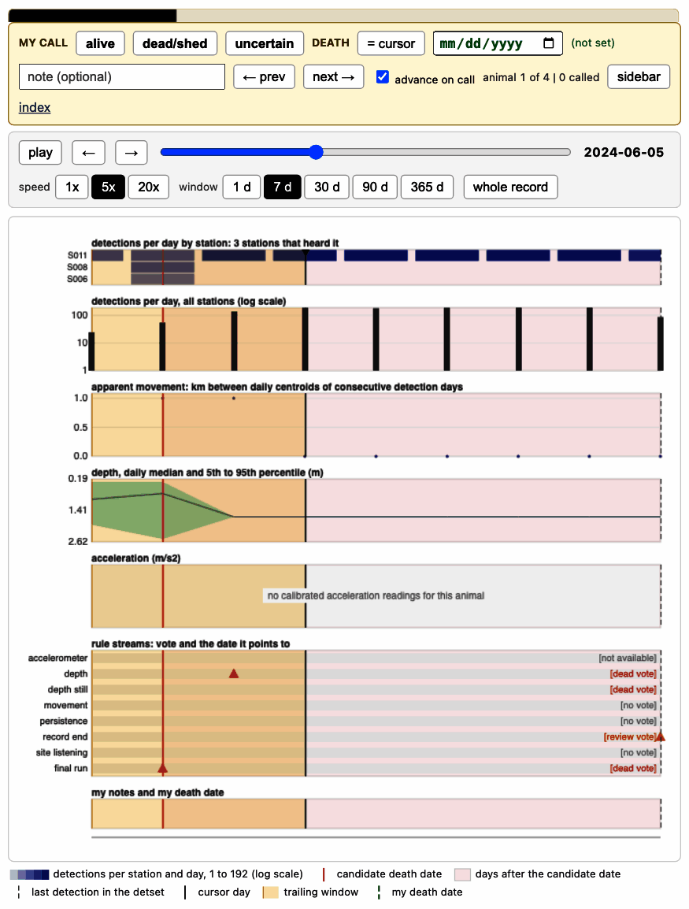

```{r setup, include = FALSE, purl = FALSE}
knitr::opts_chunk$set(collapse = TRUE, comment = "#>", fig.width = 7,
                      fig.height = 4.6,
                      out.width = "100%", dpi = 96)
# Print to 76 columns; with the "#> " prefix a printed line is at most 79.
options(width = 76)
# Wrap long lines of output, such as the text of an error, to the column
# so that the remedy at their end is in view.
local({
  wrap <- function(hook) {
    force(hook)
    function(x, options) {
      lines <- strsplit(x, "\n", fixed = TRUE)[[1]]
      wide <- startsWith(lines, "#> ") & nchar(lines) > 79
      lines[wide] <- vapply(lines[wide], function(l) {
        body <- sub("^#> ", "", l)
        lead <- nchar(sub("^( *).*$", "\\1", body))
        body <- strwrap(body, width = 75, indent = lead, exdent = lead + 2)
        paste0("#> ", body, collapse = "\n")
      }, "")
      hook(paste0(paste(lines, collapse = "\n"), "\n"), options)
    }
  }
  for (h in c("output", "message", "warning", "error")) {
    knitr::knit_hooks$set(setNames(list(wrap(knitr::knit_hooks$get(h))), h))
  }
})
# Write counts below ten as words in the text.
nw <- function(n) {
  if (n < 10) c("no", "one", "two", "three", "four", "five", "six", "seven",
                "eight",
                "nine")[n + 1] else format(n, big.mark = ",")
}
cap_nw <- function(n) {
  w <- nw(n)
  paste0(toupper(substr(w, 1, 1)), substring(w, 2))
}
# Write a UTC time as "14:24 UTC on 2 June".
when <- function(t) {
  t <- as.POSIXct(t, tz = "UTC")
  paste(format(t, "%H:%M UTC on"), as.integer(format(t, "%d")), format(t, "%B"))
}
```

A tag that stops moving can belong to a dead animal, a shed tag or an immobile animal.
Detections alone cannot always separate the three, so in **detqc** rules flag the candidates and
you make each call. This page runs a mortality detection algorithm to flag potential mortality
states, writes review cards that open in your browser, stores your calls in the detection set, and
removes and logs the detections after each mortality or shedding date.

Cards and calls go to `out_dir`, set below to a temporary folder; point it at a folder beside
your data.

```{r out-dir}
# Change to a folder beside your data, such as "C:/telemetry/2024/processed".
out_dir <- tempdir()
```

## The example

The example is `example_mortality`, included with the package: the Stoney Lake study of [Get
started](detqc.html), already read, calibrated and filtered, with the simulated fate of each
animal. ST-02 and ST-03 carry depth sensors,
and one of the four dies part-way through. Use your own filtered set in its place. The rules read
which receivers listened on each day, so `audit_listening()` runs first. With your own data, audit
before the filters, as [Get started](detqc.html#audit-the-listening-days) does. Every receiver of
this array worked, so the code names them all in `known_listening`.

```{r detset}
library(detqc)
# Build the detection set from the included study, depth already in metres
detections <- example_mortality$detections
deployments <- example_mortality$deployments
animals <- example_mortality$animals
dets <- detset(detections, deployments, animals)
# Record which receivers listened; every receiver here worked
dets <- audit_listening(dets,
                        known_listening = unique(dets$deployments$receiver_serial))
# Print the prepared set
dets
```

## Step 1. Flag: sort the animals into mortality bands

`detect_mortality()` sorts every detected animal into one of three bands for you to review on a
card. No detection is removed until you call an animal dead.

The bands come from rule streams. A stream is one rule that tests one kind of evidence in each
animal's record: the final-run stream asks whether the last days of detections fall at one site,
and the depth stream asks whether the depth reading stops changing. Each stream votes dead, alive
or review for each animal, or gives no vote. The deciding streams set the band; an evidence
stream, such as the depth stream, shows its vote on the card and does not move the band. A site
is a group of stations within `sites_km` (1 km by default) of each other, so two receivers that
hear one dead tag count as one place.

- **dead**: a stream found death evidence, such as a final run of detections at one site, and no
  stream found the animal alive after it.
- **review**: the evidence is mixed, or the rules cannot see enough: a death vote beside an alive
  vote, a final run near one site, a sparse record, or a record that ends near the end of tag
  life or of the data with no earlier death evidence.
- **alive**: no death evidence, on a record that ended well before tag life and the end of the
  data.

An animal heard to the end of the study is never in the alive band: the rules cannot see what
happened after its last detection.

```{r bands-default}
# Band the animals with the default streams
detect_mortality(dets)
```

Every animal is in review as a sparse record. `mortality_rules()` lists the streams with their
settings, which suit studies of months; the final-run stream needs
`r mortality_rules()$terminal_run$settings$min_days` detection days.

```{r rules}
# Print the default streams and their settings
mortality_rules()
```

`terminal_run` votes dead when the last days of detections fall at
one site, and `accel_flatline` and `depth_flatline` look for a sensor that stops changing to the
end of the record. `movement_resumption` votes alive when the animal is heard away from that site
later, `record_end` votes review on a record that ends near the tag's life or the end of the data,
`site_listening` counts the days the last site's receivers listened after the last detection, and
`persistence` scores how little the core stations change, which orders the review band. A stream
votes "unavailable" for an animal it cannot judge, such as one with no sensor of its kind.

The settings below scale the streams to this nine-day study; a setting given by name applies to
every stream that has it. Shorter
settings flag more animals. Set them from what your species does: a three-day rest at one
station is common in some species and rare in others.

```{r scaled-rules}
# Scale the streams to nine days: a final run of 3 detection days and
# 3 calendar days, 2 flat sensor days, a record end within 2 days
mort_rules <- mortality_rules(min_days = 3, min_calendar_days = 3,
                              min_flat_days = 2, within_days = 2)
```

`detect_mortality()` with these rules gives each animal its band and candidate death date.

```{r bands}
# Band the animals with the scaled streams
bands <- detect_mortality(dets, rules = mort_rules)
bands
# Show each animal's band, deciding rule, candidate date and depth vote
bands$bands[, c("animal_id", "band", "deciding_rule", "death_date",
                "depth_flatline_vote", "record_end_vote")]
```

```{r band-counts, include = FALSE, purl = FALSE}
st02 <- bands$bands[bands$bands$animal_id == "ST-02", ]
# Guard the sentences below against a change in the bands
rule_of <- setNames(bands$bands$deciding_rule, bands$bands$animal_id)
stopifnot(rule_of[["ST-01"]] == "terminal_run_stray",
          all(rule_of[c("ST-03", "ST-04")] == "record_end"),
          all(bands$bands$record_end_vote == "review"))
# The window record_end treats as the end of the data, in days
end_window <- mort_rules$record_end$settings$within_days
# Hours from each animal's last detection to the end of the data
det_s <- as.numeric(dets$detections$datetime)
last_det <- tapply(det_s, dets$detections$animal_id, max)
end_gap_h <- round((max(det_s) - last_det) / 3600, 1)
stopifnot(end_gap_h[["ST-04"]] == 0, end_gap_h[["ST-03"]] < 24 * end_window)
# Days from ST-02's candidate death date to its last detection: more than
# the window, so the record-end vote does not block its dead band
st02_gap_d <- round(as.numeric(difftime(st02$last_detection, st02$death_date,
                                        units = "days")), 1)
stopifnot(st02$band == "dead", st02_gap_d > end_window)
# ST-02's depth vote: flat days to the end of the record and the first flat
# day
depth_vote <- bands$votes[bands$votes$animal_id == "ST-02" &
                            bands$votes$rule == "depth_flatline", ]
stopifnot(depth_vote$vote == "dead")
flat_from <- as.Date(depth_vote$date, tz = "UTC")
```

ST-02 is in the dead band. Its candidate death date, `r when(st02$death_date)`, is the first
detection of its final run at one site; the death may be later, because an animal may hold
station alive before it dies. The simulation that made these files killed ST-02 at
`r when(example_mortality$fates$death_datetime[example_mortality$fates$animal_id == "ST-02"])`,
part-way into that run, and the sensor record on the card is what you use to set the date. The
depth stream votes dead as well: ST-02's depth is flat on its last `r nw(depth_vote$score)` days,
from `r as.integer(format(flat_from, "%d"))` `r format(flat_from, "%B")`. ST-01 stays in review
because its final days fall at one site apart from stray detections on a few days
(`terminal_run_stray`). ST-03 and ST-04 are in review because their records end within
`r nw(end_window)` days of the end of the data (`record_end`). `record_end` votes review for
ST-02 as well; its death evidence starts before that window, so it stays in the dead band.

The depth record shows when it died (Figure 1).

```{r flat-start, include = FALSE, purl = FALSE}
# Sort ST-02's depth readings in time order, and find the first reading
# from which every later one is within 0.1 m of the last
st02_depth <- dets$detections[dets$detections$animal_id == "ST-02" &
                                !is.na(dets$detections$sensor_value), ]
st02_depth <- st02_depth[order(st02_depth$datetime), ]
flat_depth <- round(st02_depth$sensor_value[nrow(st02_depth)], 1)
moving <- abs(st02_depth$sensor_value - flat_depth) > 0.1
flat_start <- st02_depth$datetime[max(which(moving)) + 1]
```

```{r depth-figure, fig.height = 3.6, fig.alt = "Calibrated depth of ST-02 and ST-03 over time; ST-02's depth still changes after the red line at its candidate death date and stays at one depth from early on 4 June.", fig.cap = sprintf("**Figure 1.** Calibrated depth of the two walleye with depth sensors (%s readings for ST-02 and %s for ST-03). ST-02's depth still changes after its candidate death date, %s, and holds at %s m from %s, the simulated death.", format(sum(depth$animal_id == 'ST-02'), big.mark = ','), sum(depth$animal_id == 'ST-03'), when(st02$death_date), flat_depth, when(flat_start))}
# Take ST-02's band row, with its candidate death date
st02 <- bands$bands[bands$bands$animal_id == "ST-02", ]
# Keep the detections that carry a depth reading
depth <- dets$detections[!is.na(dets$detections$sensor_value), ]
# Plot depth against time, one panel per animal, the candidate date on ST-02
ggplot2::ggplot(depth, ggplot2::aes(datetime, sensor_value)) +
  ggplot2::geom_point(shape = 16, size = 0.6, colour = "#31688E") +
  ggplot2::geom_vline(data = data.frame(animal_id = "ST-02",
                                        candidate = st02$death_date),
                      ggplot2::aes(xintercept = candidate,
                                   colour = "Candidate death date"),
                      linetype = 2) +
  ggplot2::scale_colour_manual(name = NULL, values = c("Candidate death date" = "red3")) +
  ggplot2::facet_wrap(~animal_id, ncol = 2) +
  ggplot2::scale_y_reverse() +
  ggplot2::labs(x = "Date (UTC)", y = "Depth (m)") +
  theme_positionr() +
  ggplot2::theme(legend.position = "bottom")
```

`depth_flatline` votes dead on the flat end of ST-02's record. ST-03 moves up and down
through the water to its last reading, and the stream gives it no vote.

### Assigning a rule of your own

`mortality_rule()` adds an evidence stream. The one below reads the calibrated depth readings and
votes dead when the last 48 hours of an animal's readings vary by less than 0.1 m. With `kind =
"evidence"`, as here, it shows on the cards beside the other streams and never decides a band; a
stream made with `kind = "vote"` decides. `?mortality_rule` lists the tables a stream receives.

```{r own-rule}
# Define a stream: dead when the last 48 h of depth vary by under 0.1 m
depth_still <- mortality_rule("depth_still", function(data, settings) {
  # Keep the depth readings; last_hours() keeps an animal's last hours
  depth_readings <- data$readings[data$readings$class == "depth", ]
  last_hours <- function(readings) {
    readings[readings$datetime >= max(readings$datetime) -
               settings$hours * 3600, ]
  }
  # Vote once per animal from the spread of its last hours of depth
  vote_one <- function(animal_readings) {
    sd_m <- stats::sd(last_hours(animal_readings)$value)
    data.frame(animal_id = animal_readings$animal_id[1],
               vote = if (sd_m < settings$sd_m) "dead" else "none",
               detail = sprintf("depth SD %.2f m over the last %d h", sd_m,
                                settings$hours))
  }
  votes <- lapply(split(depth_readings, depth_readings$animal_id), vote_one)
  do.call(rbind, votes)
}, kind = "evidence", settings = list(hours = 48, sd_m = 0.1), label = "depth still")
```

Added to the rule set, the stream votes beside the others.

```{r own-rule-run}
# Add the stream to the rule set and band the animals again
mort_rules$depth_still <- depth_still
bands <- detect_mortality(dets, rules = mort_rules)
bands$bands[, c("animal_id", "band", "depth_still_vote")]
```

## Step 2. Open the review cards

`review_mortality()` writes one card per animal in the dead and review bands and an index of
every animal, then opens the index in your browser; `all = TRUE` writes a card for the alive band
too. [The four review cards](../example/mortality_review/index.html) of the Get started page show
a dead animal and three in review. The cards are plain HTML files, so a co-author who does not
use R can read them. An `sf` polygon of the water body, passed in `control`, is drawn under the
card map; here it is made from the depth raster of Stoney Lake.

```{r cards}
# Make the lake outline for the card maps from the depth raster
lake <- terra::rast(system.file("extdata", "stoney_depth.tif",
                                package = "detqc"))
outline <- sf::st_as_sf(terra::as.polygons(terra::ifel(is.na(lake), NA, 1)))
# Write the cards and the index, and open the index in a session
review_dir <- file.path(out_dir, "mortality_review")
dets <- review_mortality(dets, review_dir, bands = bands, open = interactive(),
                         control = list(outline = outline))
dets$cards[, c("animal_id", "band", "bytes", "checked")]
```

The detection set lists the cards in `dets$cards`; `checked = TRUE` means the numbers on the card
matched the detection set. `build_mortality_cards()` writes the cards; call it yourself to write
them without opening a browser, or for one band only:

```{r dead-cards}
# Write cards for the dead band only, without opening a browser
dead_only <- build_mortality_cards(dets, bands,
                                   file.path(out_dir, "dead_cards"),
                                   which = "dead",
                                   control = list(outline = outline))
dead_only$cards[, c("animal_id", "band", "checked")]
```

```{r card-window, include = FALSE, purl = FALSE}
# Read the cursor the screenshots were taken with (tools/vignette_screenshots.R)
shot <- jsonlite::read_json("figures/screenshots.json")$review_card_top.png
day_text <- function(d) {
  d <- as.Date(d)
  paste(as.integer(format(d, "%d")), format(d, "%B %Y"))
}
```

```{r card-top, echo = FALSE, purl = FALSE, out.width = "100%", fig.alt = "Screenshot of the top of the review card of ST-02: the header and the map of the stations that heard it.", fig.cap = sprintf("**Figure 2.** Top of the review card of ST-02, with the cursor on %s.", day_text(shot$cursor))}

```

```{r card-panels, echo = FALSE, purl = FALSE, out.width = "100%", fig.alt = "Screenshot of the time panels of the ST-02 review card, from detections per station to the rule votes.", fig.cap = "**Figure 3.** Lower part of the same card. From 4 June the tag is heard every day at S011, the centroid stops moving, and the depth is flat."}

```

How to read a card:

- Start with the time panels (Figure 3), below the map. A dead animal or a shed tag gives a record
  that changes from many stations to the same one or two, every day, with no movement after and,
  on a depth tag, no change in depth.
- A card opens with its cursor on the first day of the record. Move the cursor with the slider or
  the arrow keys (Shift and an arrow moves 7 days; **Home** and **End** go to the first and the
  last day). The map shows the window that ends at the cursor (Figure 2). Space plays the record.
- Widen the browser window if the table beside the map is cut off.
- Make the call with the buttons or the keys: **A** alive, **D** dead or shed, **U** uncertain.
  D takes the candidate death date. For another date, move the cursor to the day and press **X**,
  or type the date.
- Write a note when the call is not obvious. **N** and **P** move to the next and previous animal.
- On the index, **Export my calls (CSV)** downloads every call, date and note as one file.

The browser that made the calls stores them until you export them. Export before you close the
browser or change computers. **Import calls (CSV)** restores them.

## Step 3. Decide: bring your calls back

In your study, the file comes from the export button of the index, named such as
`mortality_calls_2024-06-12.csv`. Here a block of code stands in for the reviewer and writes a
file in the same layout: ST-02 dead or shed at 02:00 UTC on 4 June, dated from the depth record
where it went flat, later than its candidate date of `r when(st02$death_date)`; and the other three
alive. With your own data, skip the block and use your exported file.

```{r stand-in-calls}
# Write one row per animal: ST-02 dead or shed at 02:00 UTC on 4 June, the
# rest alive, with the candidate date the card showed
calls <- bands$bands[, c("animal_id", "band")]
calls$call <- ifelse(calls$animal_id == "ST-02", "dead_or_shed", "alive")
calls$candidate_date <- format(as.Date(bands$bands$death_date))
calls$candidate_date[is.na(calls$candidate_date)] <- ""
calls$death_date <- ifelse(calls$call == "dead_or_shed", "2024-06-04", "")
calls$death_time <- ifelse(calls$call == "dead_or_shed", "2024-06-04 02:00:00",
                           "")
calls$date_source <- ifelse(calls$call == "dead_or_shed", "typed", "")
calls$note <- ifelse(calls$call == "dead_or_shed",
                     "depth flat from 4 June; one station", "")
# Write the calls file, as the index would export it
calls_file <- file.path(out_dir, "mortality_calls.csv")
write.csv(calls, calls_file, row.names = FALSE)
calls[, c("animal_id", "call", "death_date", "death_time", "date_source")]
```

`apply_mortality_calls()` reads the file and stores each call in the detection set.

```{r apply}
# Store the calls in the detection set
dets <- apply_mortality_calls(dets, calls_file)
dets$mortality[, c("animal_id", "call", "death_date", "death_time", "date_source")]
```

The simulation that made the example files records each animal's fate, and the calls agree with
it:

```{r fates}
# Print the simulated fate of each animal
example_mortality$fates
```

`filter_mortality()` removes each dead or shed animal's detections from `margin_days` days before
its death, 7 by default, to remove any behaviour leading up to death. A call with a death time
cuts at that time less the margin; a call with a date only cuts by whole UTC days. Alive and
uncertain animals keep every detection.

```{r lived, include = FALSE, purl = FALSE}
fates <- example_mortality$fates
lived_h <- as.numeric(difftime(fates$death_datetime[fates$animal_id == "ST-02"],
                               min(animals$release_datetime), units = "hours"))
```

This study is nine days long and ST-02 died `r lived_h` h after release, so the default margin would
remove its whole record. The code counts what each margin removes.

```{r margin}
# Count detections removed with margins of 7 days (the default) and 1 day
sapply(c(margin_7_days = 7, margin_1_day = 1), function(days) {
  cut <- filter_mortality(dets, margin_days = days)
  nrow(dets$detections) - nrow(cut$detections)
})
```

The cut below uses a margin of 1 day.

```{r filter}
# Remove ST-02's detections from 1 day before its death time
dets <- filter_mortality(dets, margin_days = 1)
tail(detset_log(dets)[, c("step", "rows_before", "rows_after", "removed")], 2)
```

```{r filter-counts, include = FALSE, purl = FALSE}
log_table <- detset_log(dets)
cut_n <- log_table$removed[log_table$step == "filter_mortality"]
```

The cut removed `r format(cut_n, big.mark = ",")` detections of ST-02, every one after 02:00 UTC
on 3 June. The set now holds `r format(nrow(dets$detections), big.mark = ",")` detections.
The log records the calls file.
`processing_report(dets, file, bands = bands)` adds the bands and the calls to the report, as in
[the processing report](../example/processing_report.html) of the Get started page. The report
does not link to the cards, so keep the review folder beside it.

## When new data arrive

`reconcile_mortality()` lists the calls that new data put in question, such as an animal called
alive that is now in the dead band, or one called dead and heard away from where it died
(`?reconcile_mortality` lists every case). It changes no
call; you make the new ones on the cards. Add the new detections, build the detection set again,
apply the same calls file and run `detect_mortality()` before it.

Below, a second download stands in for new data: three detections of ST-02 at S014 on 9 June,
five days after its death date. A predator that ate the tag and swam off would leave such a
record.

```{r new-data}
# Make three detections of ST-02 at S014 on 9 June
new_dets <- detections[rep(which(detections$animal_id == "ST-02")[1], 3), ]
new_dets$datetime <- as.POSIXct("2024-06-09 10:00:00", tz = "UTC") +
  c(0, 150, 290)
new_dets$receiver_serial <- "R014"
new_dets$station_id <- "S014"
# Rebuild the detection set with the new detections
dets_new <- detset(rbind(detections, new_dets), deployments, animals)
```

The same calls file applies to the rebuilt set, and `reconcile_mortality()` compares the calls with
the new bands.

```{r reconcile}
# Apply the same calls, band again, and list the calls the new data question
dets_new <- apply_mortality_calls(dets_new, calls_file)
dets_new <- reconcile_mortality(dets_new,
                                detect_mortality(dets_new, rules = mort_rules))
dets_new$reconcile[, c("animal_id", "call", "band", "needs_review",
                       "reason")]
```

ST-02 is listed as moved after the death date; the other three calls stand. Open its card again
with `review_mortality()`, decide whether the new detections are the animal's, and export the new
call.

## Next

- [Export the dataset and generate a summary report](exporting.html): hand the set to the
  [**glatos**](https://ocean-tracking-network.github.io/glatos/) and [**actel**](https://actel.trackyverse.org/) R packages, the ATO tables or the
  [**detfield**](https://jakebrownscombe.github.io/detfield/) R package, the positioning component of positionR.
- [Position fish from a cleaned detection
  set](https://jakebrownscombe.github.io/detfield/articles/from-detqc.html), in **detfield**, positions
  the same study.

The code of this page is also a plain R script:
`system.file("scripts", "mortality-review.R", package = "detqc")`; set `out_dir` and the calls
file to your own before you run it.
